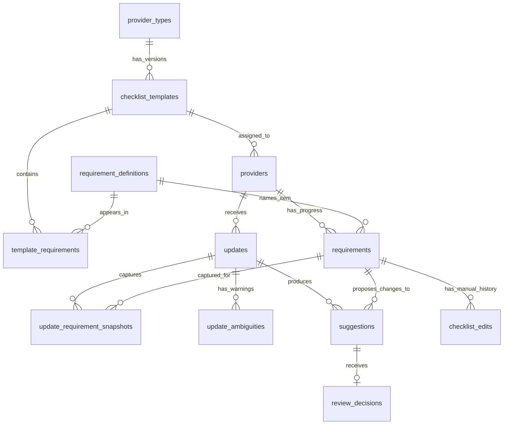

# Database Design

## Purpose and scope

This document records the reviewed PostgreSQL data model for the synthetic
provider-onboarding prototype. It is a design reference, not an implementation
plan or executable SQL. Keep `docs/proposal.md` unchanged.

The implemented relational model contains **twelve application tables**, described
by [the generated schema](../db/schema.sql) and
[the migration definitions](../db/migrations/). The first three migrations describe
the former eight-table UUID/JSON schema; the fourth performs the coordinated
integer-ID conversion, complete-checklist versioning, and normalized snapshots and
warnings. The fifth adds provider-only checklist rows and immutable initial
values for creation recovery, retaining twelve tables. Existing app workflows use
that schema. Migrations are not applied
automatically; follow [the cutover runbook](database-cutover.md) for an existing
database and obtain explicit authorization before changing Neon.

The `archived_at` field, active/archived viewing, and archived write guards are
implemented. Archive/Restore/Delete action endpoints and buttons remain future
work, as does managed sign-in. The lifecycle rules below describe their agreed
behavior; documentation does not imply that those controls are available.

Use synthetic provider records and administrative updates only. Preserve original
messages, proposed changes, supporting evidence, and independent Manager decisions.
Keep authorization and workflow rules in Python, request/model validation in
Pydantic, and relational integrity in PostgreSQL. Use raw SQL and dbmate for schema
changes. No ORM is used; this document describes the model rather than defining executable SQL.

## Design choices

The **Provider creation walkthrough** below uses the same checklist model for
standard rows and creation-time provider-only requirements. Schema availability
in a deployed database must be verified with dbmate; committing or merging a
migration does not apply it.

- **Version complete checklists.** A checklist template row identifies one provider
  type and one `template_version`. Providers reference the version assigned at
  creation. A revised checklist gets another version; existing providers and their
  progress keep their assigned version.
- **Use shared definitions and membership rows.** Requirement names live in
  `requirement_definitions`; `template_requirements` relates them to complete
  checklist versions. This preserves named historical definitions without copying
  parent names into provider checklist or audit rows.
- **Keep provider progress separate.** `requirements` stores each provider's saved
  status, requirement date, deadline, and change counter. Catalog changes do not
  alter those values or silently backfill an established checklist.
- **Archive and delete serve different needs.** Archiving preserves all records
  and supports restoration. Confirmed permanent deletion removes the provider and
  all provider-owned history; shared catalog records remain.
- **Store captured state relationally.** Per-update requirement snapshots and
  ambiguity rows replace lists embedded in JSON. Original free-text messages and
  supporting quotations remain text evidence.

A single mutable checklist with only its current version number would lose the
contents of previous versions. A JSON checklist or warning array would conflict
with the requirement to store relationships and multiple values as related rows.
A retirement timestamp alone does not identify a complete checklist version, so
no `retired_at` column is included in this target model.

## Common column and constraint conventions

- Every non-junction table has `id integer GENERATED ALWAYS AS IDENTITY PRIMARY KEY`.
  Identity values are database-generated, not submitted as retry identities.
- The two junction tables use the composite primary keys stated below and have no
  additional `id` column. All primary-key columns are required.
- Every other required column is `NOT NULL`. Optional columns allow `NULL` and
  default to `NULL`. Required columns have no default unless explicitly listed.
- Calendar dates use `date`; moments use `timestamptz`. Transaction-time defaults
  use `now()`; the manual edit event time uses `clock_timestamp()`.
- Names, saved/proposed statuses, original update text, and ambiguity messages are
  nonblank after trimming. Status wording is preserved; do not impose a single
  fixed status enumeration on every requirement.
- Compare provider-type and requirement-definition names after trimming surrounding
  spaces and ignoring capitalization. Enforce uniqueness with unique indexes over
  those normalized names, while keeping a readable canonical display label.
  `Dentist` and `dentist` identify the same provider type.
- Provider display names may repeat. They never establish record identity.
- Every relationship uses a foreign key, including composite ownership/membership
  relationships. Every foreign key explicitly states its `ON DELETE` behavior.
- One-to-one relationships also make their foreign key unique. Fixed small sets
  of text values use `CHECK` constraints.
- Do not store lists, arrays, or relationship collections in a column. Do not copy
  parent names into child columns. A verbatim update or quotation can mention a
  name because it is original evidence, not a replacement for a foreign key.
- Each one-line description immediately above a table below is also the required
  comment describing what one row stores in an eventual SQL migration.

## Entity relationship diagram

This diagram shows the implemented relational model. Composite ownership and
standard-row template-membership constraints are specified separately below.

## Column-level model

### 1. `provider_types`

One row stores one provider type.

| Column | PostgreSQL type | Required | Default / constraint |
| --- | --- | --- | --- |
| `id` | `integer` | Yes | Identity primary key |
| `name` | `text` | Yes | Nonblank; normalized name unique |

A provider type has many checklist versions. Additional types require validated
requirements; this design does not invent new provider-type fixtures.

Engineering clarification: keep a provider-type name immutable once a checklist
version references it. This preserves historical analysis context through
references without copying type labels into child records. Type renaming is
outside this scope.

### 2. `requirement_definitions`

One row stores one reusable requirement definition.

| Column | PostgreSQL type | Required | Default / constraint |
| --- | --- | --- | --- |
| `id` | `integer` | Yes | Identity primary key |
| `name` | `text` | Yes | Nonblank; normalized name unique |

A definition can be shared across versions and provider types. This means one
canonical `Drug screening` definition can appear in several checklists, rather
than introducing case-only duplicates. Once used, its name is immutable. A changed
name uses a new definition in a new checklist version; historical references keep
the original label. Definition rows contain no statuses or provider progress.

### 3. `checklist_templates`

One row stores one complete checklist version for a provider type.

| Column | PostgreSQL type | Required | Default / constraint |
| --- | --- | --- | --- |
| `id` | `integer` | Yes | Identity primary key |
| `provider_type_id` | `integer` | Yes | Foreign key to `provider_types.id` |
| `template_version` | `integer` | Yes | Positive; unique together with `provider_type_id` |

One provider type can have Dentist checklist v1, v2, and later versions. Version
numbers belong to the whole checklist, not individual requirement definitions.
The greatest configured version number is the version for new providers. It must
have configured requirements. Existing versions and their membership are immutable
once assigned; version administration has no new user interface in this scope.

### 4. `template_requirements` — junction table

One row assigns one requirement definition to one checklist version.

| Column | PostgreSQL type | Required | Default / constraint |
| --- | --- | --- | --- |
| `checklist_template_id` | `integer` | Yes | Foreign key to `checklist_templates.id` |
| `requirement_definition_id` | `integer` | Yes | Foreign key to `requirement_definitions.id` |

The primary key is `(checklist_template_id, requirement_definition_id)`. A pair
cannot repeat. This table implements the many-to-many relationship between
complete checklist versions and reusable requirement definitions.

### 5. `providers`

One row stores one fictional provider and their assigned checklist version.

| Column | PostgreSQL type | Required | Default / constraint |
| --- | --- | --- | --- |
| `id` | `integer` | Yes | Identity primary key |
| `creation_request_id` | `uuid` | Yes | Unique creation retry identity |
| `name` | `text` | Yes | Nonblank; duplicates allowed |
| `checklist_template_id` | `integer` | Yes | Foreign key to `checklist_templates.id` |
| `proposed_start_date` | `date` | No | NULL |
| `archived_at` | `timestamptz` | No | NULL means active |

Provider type is obtained through the assigned checklist version, with no copied
type name or separate redundant type field. Provider name, proposed start date,
and assigned version stay fixed in this scope; profile editing and version
upgrades are not included. Archive/restore changes only the archive state.

A creation retry with the same identity and same input returns the existing
provider without resetting progress. Conflicting input under that identity fails.
New-provider creation checks the reviewed template ID and membership fingerprint
against the selected type's current version, then atomically initializes an
independent checklist. Standard rows start Outstanding with empty dates and
deadlines; additions use the Manager's reviewed initial values. All new checklist
change counters start at zero. A changed catalog requires another review before
creation. Retry comparison uses original additional values rather than current
progress, and succeeds after later progress/archive/catalog changes.

### 6. `requirements`

One row stores one provider's progress on a standard or provider-only requirement.

| Column | PostgreSQL type | Required | Default / constraint |
| --- | --- | --- | --- |
| `id` | `integer` | Yes | Identity primary key |
| `provider_id` | `integer` | Yes | Direct provider foreign key; also part of the standard provider/version foreign key |
| `checklist_template_id` | `integer` | No | Non-NULL identifies a standard membership; NULL identifies a provider-only addition |
| `requirement_definition_id` | `integer` | Yes | Direct definition foreign key; also part of standard template membership |
| `status` | `text` | Yes | Nonblank; standard creation supplies Outstanding, additions use reviewed values |
| `scheduled_date` | `date` | No | NULL; displayed as Expected completion date |
| `deadline` | `date` | No | NULL |
| `version` | `integer` | Yes | Default 0; nonnegative |
| `initial_status` | `text` | Conditional | Nonblank and required for additions; NULL for standard rows; immutable |
| `initial_scheduled_date` | `date` | No | Optional initial addition value; NULL for standard rows; immutable |
| `initial_deadline` | `date` | No | Optional initial addition value; NULL for standard rows; immutable |

For standard rows, the provider/version reference must match the assigned version,
and the version/definition pair must exist in `template_requirements`. Direct
provider/definition references protect additions whose null template ID bypasses
composite matching. A CHECK ties the presence of the initial-value receipt to row
origin, and the ownership trigger preserves origin/identity and initial values.
Later edits/reviews change current values and version only. The pair
`(provider_id, requirement_definition_id)` is unique. Names come from the referenced
definition, never a copied name column.

`version` is a checklist-item change counter for stale-write checks; it is not
an independently versioned requirement template. Every real status, requirement-date,
or deadline change increments it. Unapproved suggestions and unsaved drafts do
not change progress. Dates and deadlines remain independent.

### Provider creation walkthrough

The [Add Provider walkthrough design](superpowers/specs/2026-11-22-add-provider-walkthrough-design.md)
is implemented through the existing twelve-table model. Save requirement changes
only the modal draft; final Add provider atomically persists the provider, any
new shared definitions, and the complete checklist. A definition cannot repeat
within one provider after normalized-name comparison. Templates are never edited
by provider creation, and no live per-requirement addition/removal interface is
introduced.

The nullable source and immutable initial columns above let initial creation input
be reconstructed after later progress changes, without a JSON receipt or new
table. Stored/captured models retain each row's immutable provenance. Provider
deletion cascades to its additions and history, preserving shared definitions.

Unconfigured provider-only rows offer Outstanding, Pending, Scheduled, Incomplete,
Completed; Completed means finished and the other four mean unfinished. Known
provider/name mappings retain their existing vocabulary. Unknown standard
requirements/types and unfamiliar later statuses keep Needs review. Shared editing,
analysis, independent suggestion review, and history apply to additional rows.

Expected completion date names the existing scheduled_date field. Its optional
calendar date stays distinct from deadline; accessible help explains the difference.
The SQL/API name, saved values, and incomplete-date inference rules do not change.
Initialization produces no fabricated update, suggestion, review, or manual-edit
record. A submitted request is frozen for explicit Manager recovery in the same
browser tab, including across reloads; a confirmed save reloads its current view.

Apply migration five explicitly with DBMATE_NO_DUMP_SCHEMA=true before running
the updated app against that database. Its intentionally empty down section does
not reverse schema changes; rollback bookkeeping is not a downgrade procedure.
The separately authorized live rollout uses a verified backup and matching app
version. Managed sign-in and other deferred lifecycle controls remain outside scope.

### 7. `updates`

One row stores one original provider update and its analysis state.

| Column | PostgreSQL type | Required | Default / constraint |
| --- | --- | --- | --- |
| `id` | `integer` | Yes | Identity primary key |
| `request_id` | `uuid` | Yes | Unique analysis retry identity |
| `provider_id` | `integer` | Yes | Foreign key to `providers.id` |
| `original_text` | `text` | Yes | Nonblank; original input retained |
| `processing_state` | `text` | Yes | Checked set below; no SQL default |
| `message` | `text` | Yes | One analysis/result message |
| `failure_category` | `text` | No | Checked set below |
| `created_at` | `timestamptz` | Yes | Current transaction time |
| `completed_at` | `timestamptz` | No | NULL while unfinished |

Check `processing_state` against `processing`, `completed`, and `failed`. Check
non-NULL failure categories against `configuration`, `timeout`, and `model`.
A failure category is present exactly when processing state is failed.

The original provider context is represented by its fixed provider/type/version
references and the captured requirement rows below. There is no JSON snapshot
or ambiguity-array column. Save the original update and complete captured context
atomically before calling the model; release the database connection for the model
call. Save final suggestions and warnings together. Failed/interrupted analysis
must not expose partially reviewable suggestions. Reused request identities do
not repeat extraction; changed input under the same identity conflicts.

### 8. `update_requirement_snapshots` — junction table

One row stores one requirement's state when an update was submitted.

| Column | PostgreSQL type | Required | Default / constraint |
| --- | --- | --- | --- |
| `update_id` | `integer` | Yes | Part of update/provider foreign key |
| `requirement_id` | `integer` | Yes | Part of requirement/provider foreign key |
| `provider_id` | `integer` | Yes | Shared ownership component of both foreign keys |
| `status` | `text` | Yes | Nonblank captured value |
| `scheduled_date` | `date` | No | Captured value, including NULL |
| `deadline` | `date` | No | Captured value, including NULL |
| `requirement_version` | `integer` | Yes | Nonnegative captured change counter |

The primary key is `(update_id, requirement_id)`. Composite foreign keys require
both parents to belong to the same provider. Capture every requirement in the
provider's actual checklist, not only requirements later mentioned by extraction.
The captured values remain unchanged when current progress advances. Fixed profile
attributes and immutable definition/version references preserve the other context
without duplicating parent names.

### 9. `update_ambiguities`

One row stores one warning or ambiguity associated with an update.

| Column | PostgreSQL type | Required | Default / constraint |
| --- | --- | --- | --- |
| `id` | `integer` | Yes | Identity primary key |
| `update_id` | `integer` | Yes | Foreign key to `updates.id` |
| `message` | `text` | Yes | Nonblank warning text |

An update can have zero or more warning rows. Warning text need not be globally
unique: different updates can produce the same warning. No ordering column or
separate warning taxonomy is added.

### 10. `suggestions`

One row stores one proposed change to one provider requirement.

| Column | PostgreSQL type | Required | Default / constraint |
| --- | --- | --- | --- |
| `id` | `integer` | Yes | Identity primary key |
| `update_id` | `integer` | Yes | Part of update/provider foreign key |
| `requirement_id` | `integer` | Yes | Part of requirement/provider foreign key |
| `provider_id` | `integer` | Yes | Shared ownership component of both foreign keys |
| `requirement_version` | `integer` | Yes | Nonnegative captured change counter |
| `proposed_status` | `text` | Yes | Nonblank |
| `proposed_date` | `date` | No | NULL |
| `supporting_text` | `text` | Yes | Original supporting evidence |
| `date_text` | `text` | No | Original date wording |
| `date_inferred` | `boolean` | Yes | Default false |
| `date_explanation` | `text` | No | NULL |
| `date_requires_confirmation` | `boolean` | Yes | Default false |
| `created_at` | `timestamptz` | Yes | Current transaction time |

The update and requirement must belong to the same provider. The captured version
comes from the saved analysis context, so later progress makes an old suggestion
stale. `date_text` is evidence such as "on the 18th", not a calendar date stored
as text. Apply the proposal's incomplete-date policy; the provider's proposed
start date remains its reference, without substituting today's date.

### 11. `review_decisions`

One row stores the terminal Manager decision on one suggestion.

| Column | PostgreSQL type | Required | Default / constraint |
| --- | --- | --- | --- |
| `id` | `integer` | Yes | Identity primary key |
| `suggestion_id` | `integer` | Yes | Foreign key to `suggestions.id`; unique |
| `outcome` | `text` | Yes | Checked set below |
| `previous_status` | `text` | Yes | Nonblank |
| `previous_scheduled_date` | `date` | No | Prior value, including NULL |
| `applied_status` | `text` | Conditional | Nonblank for approval/correction; NULL for rejection |
| `applied_scheduled_date` | `date` | No | NULL can represent a cleared/absent date |
| `reviewer_role` | `text` | Yes | Check equals manager |
| `reviewed_at` | `timestamptz` | Yes | Current transaction time |

Check outcomes against `approved`, `corrected`, and `rejected`. Rejection requires
both applied columns to be NULL and changes no checklist values. Approval or
correction requires a non-NULL applied status. The unique suggestion reference
implements one suggestion to zero or one decision.

Approval and its checklist change are atomic. Enforce Manager mode, inferred-date
confirmation, and stale-version checks in the review operation. Decisions preserve
the original suggestion; suggestion review does not alter deadlines.

### 12. `checklist_edits`

One row stores the before-and-after evidence for one direct Manager checklist save.

| Column | PostgreSQL type | Required | Default / constraint |
| --- | --- | --- | --- |
| `id` | `integer` | Yes | Identity primary key |
| `operation_id` | `uuid` | Yes | Unique manual-save retry identity |
| `provider_id` | `integer` | Yes | Part of requirement/provider foreign key |
| `requirement_id` | `integer` | Yes | Part of requirement/provider foreign key |
| `expected_version` | `integer` | Yes | Nonnegative |
| `resulting_version` | `integer` | Yes | Expected version plus one |
| `previous_status` | `text` | Yes | Nonblank |
| `previous_scheduled_date` | `date` | No | Prior value, including NULL |
| `previous_deadline` | `date` | No | Prior value, including NULL |
| `applied_status` | `text` | Yes | Nonblank |
| `applied_scheduled_date` | `date` | No | Applied value, including NULL |
| `applied_deadline` | `date` | No | Applied value, including NULL |
| `reviewer_role` | `text` | Yes | Check equals manager |
| `created_at` | `timestamptz` | Yes | Actual event time |

A check requires at least one status/date/deadline value to differ, treating NULL
as a meaningful value. There is no copied requirement-name column. Names resolve
through the requirement's immutable definition/version references.

Save the checklist change and history entry atomically. Lock the requirement and
reject stale versions. An identical operation retry returns its saved result
without reapplying progress; conflicting reused identities fail. Ordinary history
updates/deletes are prohibited, with the provider-deletion exception below.

## Foreign keys, cardinality, and deletion policy

The composite keys below are intentional integrity constraints; they prevent a
child from linking one provider's data to another provider or checklist version.
All referenced column groups must be primary or unique keys.
The two composite relationships on requirements apply to standard rows with a
non-NULL template ID; direct provider/definition relationships protect every row.

| Child columns | Referenced parent columns | Cardinality, parent to child | ON DELETE |
| --- | --- | --- | --- |
| `checklist_templates.provider_type_id` | `provider_types.id` | One to many | RESTRICT |
| `template_requirements.checklist_template_id` | `checklist_templates.id` | One to many | CASCADE |
| `template_requirements.requirement_definition_id` | `requirement_definitions.id` | One to many | RESTRICT |
| `providers.checklist_template_id` | `checklist_templates.id` | One to many | RESTRICT |
| `requirements.provider_id` | `providers.id` | One to many; all rows | CASCADE |
| `requirements.requirement_definition_id` | `requirement_definitions.id` | One to many; all rows | RESTRICT |
| `requirements.(provider_id, checklist_template_id)` | `providers.(id, checklist_template_id)` | One to many | CASCADE |
| `requirements.(checklist_template_id, requirement_definition_id)` | `template_requirements.(checklist_template_id, requirement_definition_id)` | One to many | RESTRICT |
| `updates.provider_id` | `providers.id` | One to many | CASCADE |
| `update_requirement_snapshots.(update_id, provider_id)` | `updates.(id, provider_id)` | One to many | CASCADE |
| `update_requirement_snapshots.(requirement_id, provider_id)` | `requirements.(id, provider_id)` | One to many | CASCADE |
| `update_ambiguities.update_id` | `updates.id` | One to many | CASCADE |
| `suggestions.(update_id, provider_id)` | `updates.(id, provider_id)` | One to many | CASCADE |
| `suggestions.(requirement_id, provider_id)` | `requirements.(id, provider_id)` | One to many | CASCADE |
| `review_decisions.suggestion_id` | `suggestions.id` | One to zero or one | CASCADE |
| `checklist_edits.(requirement_id, provider_id)` | `requirements.(id, provider_id)` | One to many | CASCADE |

Every "many" can be zero. Normal application creation still requires a configured,
nonempty template and initializes its full provider checklist in one transaction.
Template versions used by providers are protected from deletion. Unused version
deletion can cascade its membership rows. Referenced definitions and provider
types cannot be deleted. No catalog deletion interface is added by this design.

Provider deletion cascades through requirements and updates to all owned
snapshots, warnings, suggestions, decisions, and manual edits. No cascade points
from a provider back to shared types, definitions, or template versions. The
manual-audit protection must permit this root provider deletion while rejecting
ordinary audit mutation and deletion of a requirement to bypass that protection.

## Unique constraints and indexes

Besides primary keys and the two normalized-name unique indexes, require:

- `checklist_templates`: unique `(provider_type_id, template_version)`.
- `providers`: unique `creation_request_id` and `(id, checklist_template_id)`.
- `requirements`: unique `(provider_id, requirement_definition_id)` and
  `(id, provider_id)`.
- `updates`: unique `request_id` and `(id, provider_id)`.
- `review_decisions`: unique `suggestion_id`.
- `checklist_edits`: unique `operation_id`.

The composite unique keys containing an already-unique ID provide explicit
referenced keys for composite foreign keys; they do not merge different providers
or replace the integer primary keys.

Indexes must cover every foreign-key column used for filtering or joining. Reuse
primary-key and unique indexes where their leading columns provide coverage;
do not add redundant indexes solely because a constraint exists.

| Table | Additional index coverage beyond primary/unique keys |
| --- | --- |
| `template_requirements` | `requirement_definition_id`; its primary key already leads with `checklist_template_id` |
| `providers` | `checklist_template_id` |
| `requirements` | `(checklist_template_id, requirement_definition_id)` and `requirement_definition_id`; provider lookups have leading unique-key coverage |
| `updates` | `(provider_id, created_at, id)` |
| `update_requirement_snapshots` | `requirement_id`, `provider_id`; its primary key already leads with `update_id` |
| `update_ambiguities` | `update_id` |
| `suggestions` | `update_id`, `requirement_id`, `provider_id` |
| `checklist_edits` | `requirement_id` and `(provider_id, created_at, id)` |

The unique type/version key covers `checklist_templates.provider_type_id`.
The unique suggestion key covers `review_decisions.suggestion_id`.

## Archive, restoration, and permanent deletion

Archive/Restore/Delete action controls are deferred. Current views and server
operations already respect stored archive state, and provider-owned SQL cascades
are tested. The following rules govern the future action interface.

- Only Manager mode can archive, restore, or permanently delete a provider.
  The role remains simulated until future managed sign-in is introduced.
- Archiving sets `archived_at`, removes the provider from active onboarding, and
  preserves the assigned template version, saved checklist, updates, suggestions,
  and history. Archived records remain available for viewing.
- While archived, block new update submissions, suggestion decisions, and manual
  checklist edits. Managers can restore or permanently delete the provider.
- Restoration clears `archived_at` without changing statuses, dates, deadlines,
  checklist membership, or history. Do not reset progress or switch to the latest
  template. Existing stale-version rules still apply to saved suggestions.
- Permanent deletion requires an explicit confirmation naming the provider and
  stating **"This cannot be undone."** Delete all provider-owned rows atomically,
  whether the provider is active or archived, while preserving shared catalog rows
  and every other provider's records.
- Archiving is not a completion status. Do not change requirement statuses to
  describe the provider's lifecycle.

## Reduced synthetic example

These selected rows illustrate version references only. They do not redefine the
full synthetic Dentist fixture or settle real health-center requirements. IDs
are illustrative database-generated values.

`provider_types`

| id | name |
| --- | --- |
| 1 | Dentist |

`checklist_templates`

| id | provider_type_id | template_version |
| --- | --- | --- |
| 1 | 1 | 1 |
| 2 | 1 | 2 |

`requirement_definitions`

| id | name |
| --- | --- |
| 1 | Offer letter |
| 2 | Drug screening |
| 3 | Insurance credentialing |

`template_requirements` — selected membership rows

| checklist_template_id | requirement_definition_id |
| --- | --- |
| 1 | 1 |
| 1 | 2 |
| 2 | 1 |
| 2 | 2 |
| 2 | 3 |

`providers` — selected columns

| id | name | checklist_template_id |
| --- | --- | --- |
| 1 | Dr. Kekoa Ejemplo | 1 |
| 2 | Dr. Malia Example | 2 |

Kekoa keeps version 1 and his progress after version 2 is configured. Malia starts
with version 2. Statuses live in their individual `requirements` rows, not in the
shared template membership.

## Future work and boundaries

Managed sign-in is deferred. A future authentication service will handle
credentials; the application's account references and Manager/Proposer role
mapping will be designed then. Do not add a login, password, session, or staff
account table or password-hash column to this twelve-table target. Current
simulated roles are not real access control.

Do not add real employee data, provider-profile editing, provider version upgrades,
post-creation requirement additions/removals or other checklist exceptions,
archive-event history, document uploads,
forwarded-email processing, automated reminders, policy retrieval/RAG, model
routing, stored completion flags, or stored dashboard counts. Completion and
Hawaii-date deadline monitoring stay derived from saved statuses and deadlines.

The forward migration, data transformation, integer API contracts, captured-state
queries, programmatic template configuration, and lifecycle race guards are
implemented for existing workflows. Their local cutover/backup rehearsal and
operational gates are described in `docs/database-cutover.md`. These preserve
complete captured context, retry safety, immutable historical references, and
provider-scoped deletion. Live migration and future action controls remain
separate release decisions.

## Required migration review before execution

Read each eventual migration line by line against this checklist **before running
it**. This target design is not a claim that unwritten migrations pass the checks.

| # | Check | Defect to look for |
| --- | --- | --- |
| 1 | Every table has a primary key | Missing PRIMARY KEY; also verify the required integer identity or composite-junction form |
| 2 | Every relationship is a foreign key | A child stores a parent's name instead of referencing its ID |
| 3 | No column stores a list | Comma-separated values, relationship arrays, or nested JSON collections |
| 4 | Required columns are NOT NULL | Needed values can be NULL without a deliberate conditional rule |
| 5 | Values that must not repeat are UNIQUE | Duplicate normalized catalog names, versions, or retry identities are possible |
| 6 | A junction table cannot hold a pair twice | Missing composite PRIMARY KEY on its two relationship keys |
| 7 | Filter/join columns have index coverage | A used foreign-key column lacks a suitable leading-column index; count covering primary/unique indexes |
| 8 | Every table is needed by the approved scope | No current or explicitly agreed target feature reads, writes, or checks it; deferred login tables are an example |
| 9 | Moments use timestamptz; calendar dates use date | A resolved date or timestamp is stored as text; original date wording is legitimately text |
| 10 | Column types match their values | An arithmetic version counter is text, or an identifier type disagrees with its referenced key |
| 11 | Every foreign key states ON DELETE explicitly | A deletion policy is left to PostgreSQL's default |

Also verify nonblank and fixed-value checks, named row-purpose comments, immutable
version/history rules, ownership constraints, and preservation of other providers
and shared catalogs during deletion. Use `DBMATE_NO_DUMP_SCHEMA=true` for credentialed
connections and explicit no-dump migration commands. Generate schema snapshots only
from passwordless disposable local PostgreSQL. Keep credentials in `.env`; automated
tests use guarded disposable test databases and never the Neon application database.
