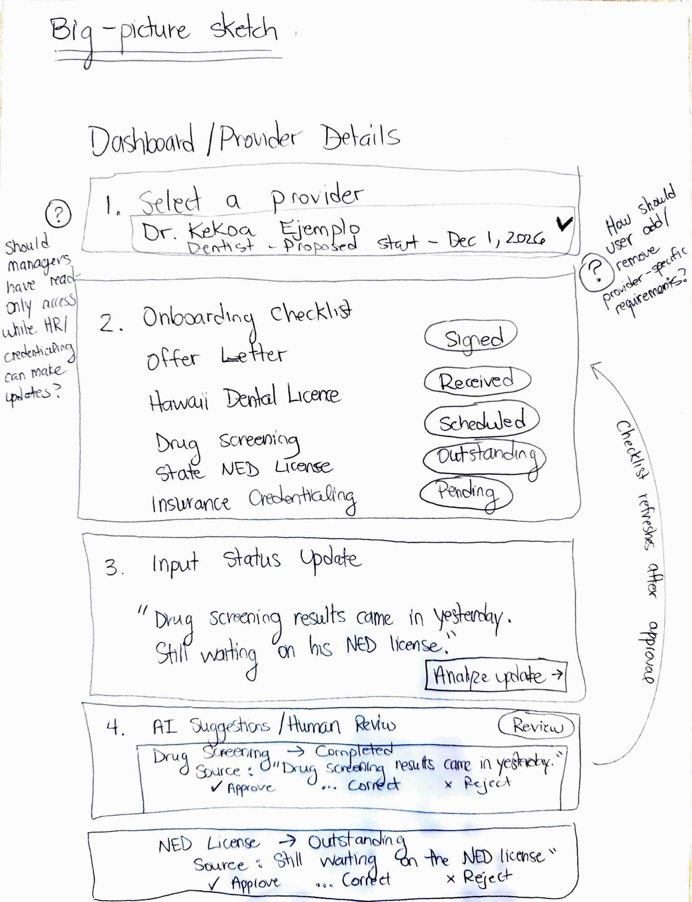
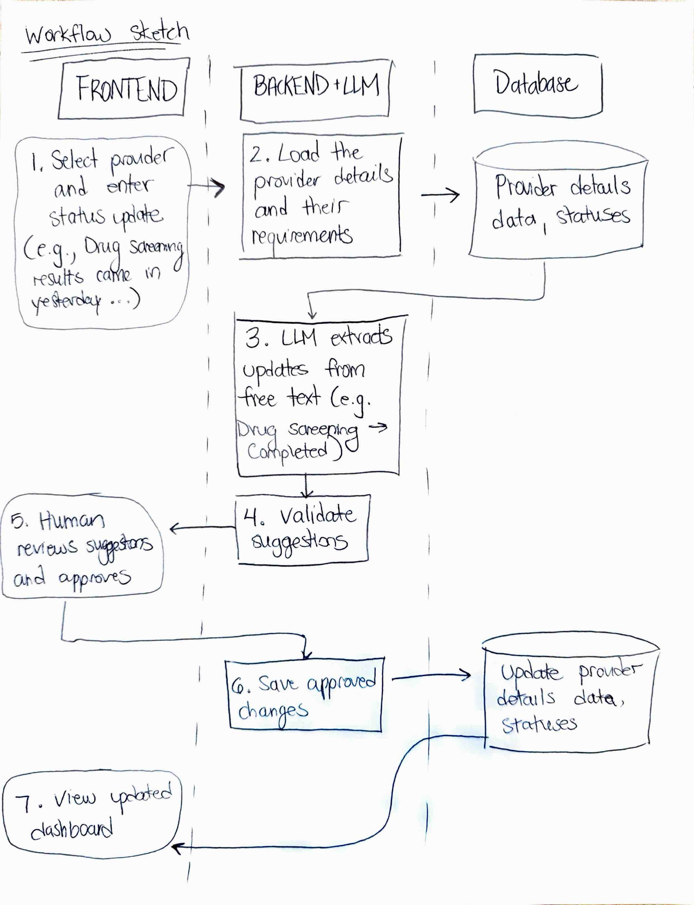

# Final Project Proposal

ICS 603  
Lizzy Pine

## Project Goal

A web app that helps community health center staff track new healthcare providers' onboarding tasks, update their progress, and see if they're on track for their first day of work.

## Intended User and Problem

The intended users are community health center managers and administrative staff involved in onboarding new employees.

The problem: Onboarding information is spread across departments such as HR and credentialing. Updates arrive through emails, messages, and conversations, making it difficult to identify outstanding requirements and next actions. A shared application would centralize this information and help authorized users track progress.

## Example Input

A staff member selects fictional provider Dr. Kekoa Ejemplo and enters this synthetic update:

> Kekoa's Hawaii dental license was received. His drug screening is scheduled for October 22. Insurance credentialing has been submitted, but approval is pending. His NED license is still outstanding.

The LLM proposes:

| Requirement | Suggested Status |
| --- | --- |
| Hawaii dental license | Received |
| Drug screening | Scheduled - Oct. 22 |
| Insurance credentialing | Submitted; awaiting approval |
| State NED license | Outstanding |

The user reviews and approves or corrects the suggestions before saving.

## Sample Input Set

Synthetic sample inputs:

| Input | Expected Result |
| --- | --- |
| "Hawaii dental license received." | License: Received |
| "Drug screen scheduled for Oct. 22." | Screening: Scheduled, Oct. 22 |
| "Credentialing was submitted." | Credentialing: Submitted |
| "Still waiting on his NED license." | NED license: Outstanding |
| "Offer letter signed and license received." | Two proposed changes |
| "Drug screen scheduled, date unknown." | Scheduled; flag missing date |
| "Drug screen will happen next Tuesday." | In the first model-connected feature, flag unsupported relative-weekday wording and leave the date unset, as specified under **Data Use > Incomplete Dates**. |
| "Actually the drug screen moved to the 29th." | Propose correcting the drug-screening date using the most recent valid 29th on or before the proposed start date, as specified under **Data Use > Incomplete Dates**. Leave it unset and warn if there is no reference start date. Apply changes only after human approval. |
| "Credentialing was returned for missing info." | Credentialing: Incomplete |

## Expected Result and Value

The application will display each provider's requirements, statuses, deadlines, and proposed start date in one place. Managers should be able to identify outstanding items without contacting multiple departments. I will evaluate this improvement by checking whether the dashboard accurately reflects approved updates in synthetic scenarios.

## Big-Picture Sketch

## Workflow or Component Sketch

## Data Source and Access

The prototype will use manually created, synthetic data modeled after the general onboarding workflow at a local community health center. No real employees’ sensitive data will be used. My contact, a health center manager, will help validate the workflow and sample scenarios.

## Up to Three Core Features

1. **Centralized Onboarding Tracker:** View provider records, requirements, statuses, deadlines, and proposed start dates.
2. **Status and Deadline Monitoring:** Identify completed, pending, outstanding, and overdue requirements using application logic.
3. **LLM-Assisted Status Update Processing:** Extract proposed changes from free-text updates, with human approval required before saving.

## LLM Role

The LLM will interpret free-text updates using the provider's current requirements and statuses. It will return proposed requirement changes, dates, and supporting text, while flagging any ambiguities.

The first model-connected feature will send the selected synthetic provider's context and original update from the page to the model and display structured suggestions. The model will extract stated date components; plain Python will resolve incomplete dates. Suggestions will not change checklist statuses.

The application will use Pydantic AI with a model identifier supplied through `LLM_MODEL` and an OpenAI-compatible gateway supplied through `LLM_API_GATEWAY`. Its token will come from `LLM_API_TOKEN`. Configuration values will be read from the environment; credentials will not be included in the page or model prompt.

Model failures will produce a visible error rather than fixed placeholder suggestions. Automated tests will use `TestModel` with real model requests disabled.

Use Pydantic validation for application request/response contracts and structured model output. Validate identifiers, roles, review decisions, nonblank text, and dates before application changes are applied. Keep business rules in plain Python and relational integrity constraints in PostgreSQL; model output must pass validation regardless of the model used.

### Future Model Routing

The application may later use semantic routing to send some requests to a local model and others to a cloud model, using OpenCode at `opencode.ai` (referred to as `opencode-ai`). Investigate its supported interfaces before choosing an implementation. The routing policy, local/cloud model choices, and fallback behavior remain open questions. This is future work, outside the Neon persistence and manager-review slice; the current model gateway and shared validation rules remain in use.

## Data Use

The application will look up the selected provider's record and applicable onboarding requirements before processing an update. It will compare proposed changes with existing requirements and statuses. For example, an update mentioning a NED license should not automatically create a new requirement if that requirement is not associated with the provider type.

For the first model-connected feature, provider context will come from the existing synthetic page fixture, without retrieval or a database. Valid suggestions will remain visible alongside warnings for unknown or non-applicable requirements. If no actionable suggestions remain after filtering, the application will report insufficient information and leave the checklist unchanged.

For the persistence and manager-review slice, the browser supplies a provider ID and update text; the server loads the authoritative checklist from PostgreSQL. Save the original update and captured provider context before extraction, and save suggestions and warnings together when extraction completes. Failed or interrupted analysis remains visible without partially reviewable suggestions. Reusing the same request ID must not repeat extraction; changed input with that ID is a conflict.

### Provider Types and Checklists

The database design will account for multiple provider types, including dentists and dental hygienists. Store provider types and their standard requirement templates separately from each provider's actual checklist. Initialize a provider's checklist from their type's templates, then retain that provider's own statuses, dates, and review history. Changing a template must not silently add, remove, or change existing checklist entries.

Individual providers may need exceptions to their type's standard checklist, but the exception policy is not yet determined. Keep provider checklist entries separate from templates so the policy can be settled later. The persistence and manager-review slice will not add exception controls or automatically create requirements from free-text updates. Validate each type's actual requirements with the health center contact rather than assuming that different types share the same checklist.

### Incomplete Dates

For a date with a month and day but no year, infer the most recent valid occurrence on or before the provider's proposed start date. For a day alone, such as "on the 18th," infer the most recent valid occurrence of that day on or before the proposed start date. For example, a January 15, 2027 start implies October 22, 2026 for "October 22," and December 18, 2026 for "on the 18th."

Use actual calendar dates when resolving incomplete dates. Preserve fully specified valid dates as stated. When there is no proposed start date, leave incomplete dates unset and warn. Missing, invalid, or unsupported date wording will not be replaced with a guessed date; show a warning when a date is needed or a date mention cannot be resolved. Do not use today's date as a fallback reference.

Inferred dates will show the original wording, the inferred date, an explanation referencing the proposed start date, and an indication that user approval is required.

### Status and Deadline Monitoring

Derive completion from each requirement's saved status using rules specific to that requirement. Keep the existing manager approval workflow; do not introduce a separate completion field or let an unapproved suggestion change monitoring results. Seeded initial statuses are also valid monitoring inputs.

For the synthetic Dentist checklist, the following statuses mean finished:

| Requirement | Finished status |
| --- | --- |
| Offer letter | Signed |
| Hawaii dental license | Received |
| Drug screening | Completed |
| State NED license | Received |
| Insurance credentialing | Approved |

These are prototype rules for synthetic examples, to be validated with the health center contact before applying them to actual workflows. Preserve the saved status wording. Match configured status values after trimming surrounding whitespace and ignoring case; unfamiliar statuses, requirements, or provider types show **Needs review** instead of a guessed completion result.

An unfinished requirement is overdue when its saved deadline is before the current Hawaii calendar date. A deadline today is due today, not overdue. A finished requirement receives no overdue warning even if its deadline has passed. A missing deadline produces no overdue warning. Keep appointment/event dates and proposed start dates separate from deadlines. This use of today's date for monitoring does not change the proposed-start-date reference for incomplete-date inference.

When completion needs review and the deadline has passed, show **Deadline passed — needs review**. Do not count that uncertain item as confirmed overdue. Show Finished, Remaining, Overdue, and Needs review counts for the selected provider. Remaining includes all requirements not known to be finished, including uncertain items; Overdue and Needs review are subsets of Remaining. Monitoring reflects a labeled as-of date and is recomputed when server data is loaded or refreshed.

Use the existing fictional dentist for these acceptance scenarios:

| Requirement | Saved status | Deadline | Expected result |
| --- | --- | --- | --- |
| Offer letter | Signed | Yesterday | Finished; no overdue warning |
| Drug screening | Scheduled | Next week | Outstanding |
| Drug screening | Completed | Yesterday | Finished; no overdue warning |
| Insurance credentialing | Incomplete | Yesterday | Outstanding and overdue |

Keep monitoring read-only. The mockup's dates are fictional test values; do not infer, populate, or change saved deadlines to make a demonstration show overdue items. Deadline entry/editing, additional provider-type rules, and readiness judgments are separate work.

## Saved Records

The database will persist the following linked records:

- **Providers:** Identity, provider type, and proposed start date.
- **Provider Types:** Named types such as Dentist and Dental Hygienist.
- **Requirement Templates:** Standard checklist entries associated with a provider type.
- **New-Hire Requirements:** Statuses and deadlines associated with each provider.
- **Updates:** Original free-text messages associated with each provider.
- **LLM Suggestions:** Proposed changes generated from each update.
- **Review Decisions:** Approvals, corrections, and rejections associated with each suggestion.

Each provider can have multiple requirements and updates, and each update can generate multiple suggestions. All records will remain available after restarting the application.

Use Neon PostgreSQL for application persistence, configured through `DATABASE_URL` in the environment. Manage the schema with dbmate SQL migrations. The initial Onboard HQ database is empty; the migrations will establish its tables. Keep credentials in the ignored `.env` file and commit only placeholders in `.env.example`. Automated database tests will use a separate PostgreSQL test database.

The first model-connected feature excludes saved records and resets temporary confirmations on refresh. The persistence and manager-review slice retains provider/checklist records, original updates and context, suggestions, and decisions across refreshes and restarts. A forward-only migration and an explicit idempotent synthetic seed establish the initial records; they do not run automatically at app startup.

## Searchable Text

Saved administrative notes will provide text that could be searched by meaning. For example, a manager might search for "credentialing delays" or "providers waiting on professional licenses" to find relevant historical updates.

Semantic search and retrieval-augmented generation (RAG) are outside the first model-connected feature.

## Human Review

Users will see the original update alongside proposed changes and supporting text. They can approve, correct, or reject each suggestion. Only approved changes will update requirement statuses. Original messages and review decisions will be retained.

Anyone can propose an update. Only a manager can approve changes that update the checklist. For the prototype, a clearly labeled simulated Proposer/Manager role switch will represent those roles; actual sign-in and authenticated role enforcement are outside this slice.

The first model-connected feature will include an editable date field and a Confirm date button for each inferred date. Confirmation will apply only to that suggested date in the current page, without approving a status change or saving a record. Editing a date will clear its confirmation, and submitting another update will reset confirmations. General suggestion approval, correction, rejection, and applying checklist status changes remain outside this feature.

In the persistence and manager-review slice, a manager's approval includes any required inferred-date confirmation. Corrected approval retains the original proposal and records the applied status/date; rejection changes no checklist values. Apply the checklist change and review decision atomically. A suggestion can receive one terminal decision, and an approval against an older checklist version must conflict rather than overwrite newer progress. Requirement dates remain separate from deadlines.

## One Failure Case

Input: "Everything looks good. We should be okay for November 1."

This is a failure case because no specific requirement is identified, the application should report insufficient information and leave existing statuses unchanged.

## Three Acceptance Criteria

1. **Successful extraction and approval:** Given an outstanding Hawaii dental license, when the user enters "We received his Hawaii dental license," then the application proposes Received and applies it only after approval.
2. **Multiple requirements:** Given drug-screening and credentialing requirements, when the user enters "Drug screen scheduled for October 22 and credentialing submitted," then the application proposes two independently reviewable changes.
3. **Ambiguous input:** Given an update without a specific requirement status, when the user enters "Everything looks good," then the application reports insufficient information and preserves existing statuses.

## Testing Strategy

The persistence and manager-review slice requires automated unit, integration, and end-to-end tests:

- **Unit tests:** Pydantic validation, pure scope/date rules, simulated-role decisions, correction rules, and stale-version checks, without a database or real model.
- **Integration tests:** FastAPI operations with a separate PostgreSQL test database, including dbmate migrations, repository persistence, atomic approvals, rejection history, duplicate/stale decisions, and errors. Use deterministic model output rather than live model calls.
- **End-to-end tests:** A real browser against the running app and isolated PostgreSQL, with `TestModel` substituted at the model boundary. Exercise proposing, switching simulated roles, manager approval/correction/rejection, and persistent checklist/history after refresh and application restart.

Run all three layers in local verification and CI. No automated test calls a real local or cloud model, or writes to the Neon application database. Keep Ruff, mypy, and the complete pytest suite as required checks.

Use pytest with real isolated PostgreSQL for integration tests and Playwright for browser tests. The browser test server substitutes `TestModel` and disables real model requests in its own process. Cover saved state after app restart, lost-response retries, stale/concurrent review, correction/rejection, date confirmation, and safe rendering of supporting text.

For status and deadline monitoring, turn the four synthetic acceptance scenarios into unit tests. Add missing/today/future/past deadline boundaries, unfamiliar statuses, completion reversals, and provider-type boundaries. Integration tests must derive monitoring from stored records; browser tests must verify counts and labels after manager approval and refresh. Use a controlled clock and fictional deadlines in the isolated test database, never the Neon application database.

## Outside Version One

The initial prototype will exclude:

- Processing of updates sent by forwarded email
- Integration of document uploads
- Automated reminders
- Real employee records

## Open Questions

### Project decisions

- Which requirements should each provider type include? The schema will support multiple types; the initial persistence/review fixture remains the existing synthetic dentist.
- Do individual providers need checklist exceptions, and how should those exceptions be reviewed and recorded? This remains undecided.
- Which additional statuses, provider-type completion rules, and deadline-entry rules apply? The synthetic Dentist's initial completion mappings and monitoring behavior are specified under **Data Use > Status and Deadline Monitoring**; validate real workflow rules with the health center contact.
- Anyone can propose updates; a manager approves checklist changes. Use simulated roles for the prototype rather than actual sign-in.
- Valid suggestions will be shown alongside warnings for unknown or non-applicable requirements; no applicable suggestions will produce an insufficient-information response.

### Technical questions

- Use Pydantic AI structured output through the configured OpenAI-compatible gateway; the model identifier is deployment configuration supplied through `LLM_MODEL`.
- Use Neon PostgreSQL, with `DATABASE_URL` supplied through the environment, and dbmate SQL migrations for schema changes.
- Investigate OpenCode (`opencode.ai`) for possible future local/cloud semantic routing; resolve its integration, routing policy, model choices, and fallback behavior in a separate slice.
- How should semantic search work?
- How should the application be deployed?

## Next Investigation

The biggest uncertainty is how to model onboarding requirements and statuses accurately while keeping the prototype small enough to complete.

I will review a typical provider onboarding workflow with my contact to identify the most important requirements, their possible statuses, and how they differ by provider type. I will also ask the manager to evaluate several synthetic HR/credentialing updates to determine whether they reflect realistic communications.

The initial persistence/review fixture will remain the existing synthetic dentist and its small checklist, while the schema supports additional types such as dental hygienists. Validate their requirements before adding more fixtures. The investigation will also help determine whether the synthetic updates provide enough detail for reliable LLM extraction and whether individual checklist exceptions are needed.
