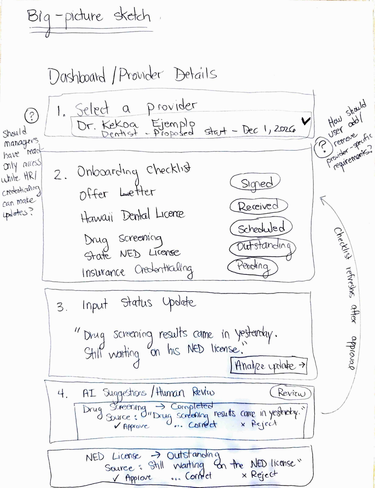
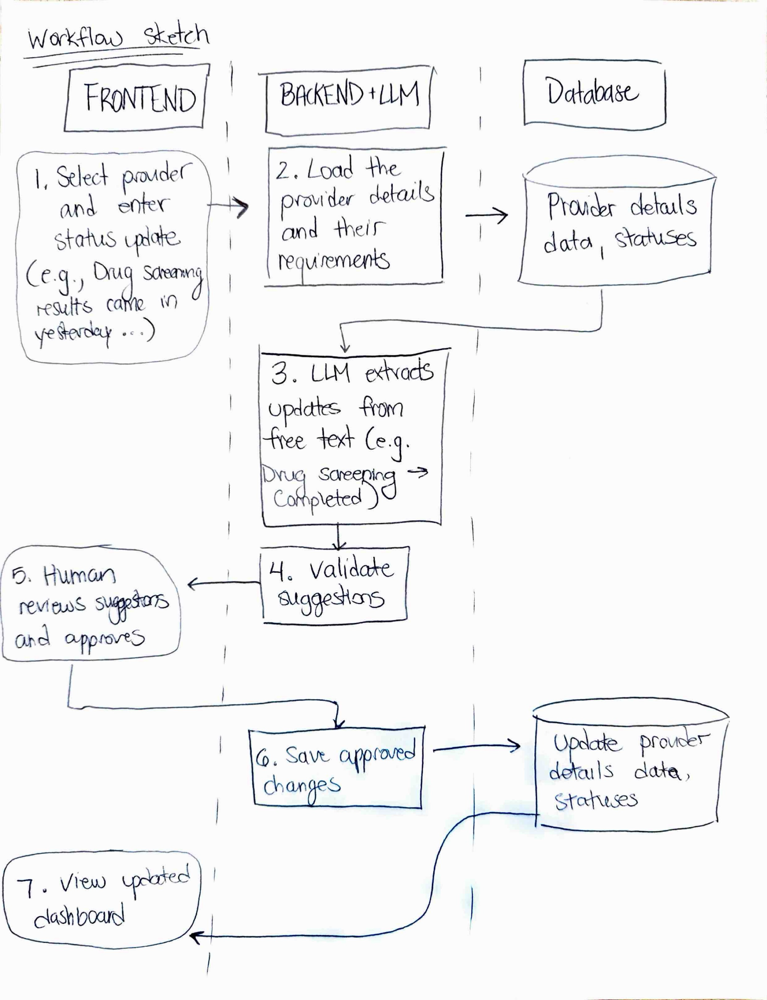

# Final Project Proposal

ICS 603  
Lizzy Pine

## Project Goal

A web app that helps community health center staff track new healthcare providers' onboarding tasks, update their progress, and see if they're on track for their first day of work.

## Intended User and Problem

The intended users are community health center managers and administrative staff involved in onboarding new employees.

The problem: Onboarding information is spread across departments such as HR and credentialing. Updates arrive through emails, messages, and conversations, making it difficult to identify outstanding requirements and next actions. A shared application would centralize this information and help authorized users track progress.

## Example Input

A staff member selects fictional provider Dr. Kekoa Ejemplo and enters this synthetic update:

> Kekoa's Hawaii dental license was received. His drug screening is scheduled for October 22. Insurance credentialing has been submitted, but approval is pending. His NED license is still outstanding.

The LLM proposes:

| Requirement | Suggested Status |
| --- | --- |
| Hawaii dental license | Received |
| Drug screening | Scheduled - Oct. 22 |
| Insurance credentialing | Submitted; awaiting approval |
| State NED license | Outstanding |

The user reviews and approves or corrects the suggestions before saving.

## Sample Input Set

Synthetic sample inputs:

| Input | Expected Result |
| --- | --- |
| "Hawaii dental license received." | License: Received |
| "Drug screen scheduled for Oct. 22." | Screening: Scheduled, Oct. 22 |
| "Credentialing was submitted." | Credentialing: Submitted |
| "Still waiting on his NED license." | NED license: Outstanding |
| "Offer letter signed and license received." | Two proposed changes |
| "Drug screen scheduled, date unknown." | Scheduled; flag missing date |

## Expected Result and Value

The application will display each provider's requirements, statuses, deadlines, and proposed start date in one place. Managers should be able to identify outstanding items without contacting multiple departments. I will evaluate this improvement by checking whether the dashboard accurately reflects approved updates in synthetic scenarios.

## Big-Picture Sketch

## Workflow or Component Sketch

## Data Source and Access

The prototype will use manually created, synthetic data modeled after the general onboarding workflow at a local community health center. No real employees’ sensitive data will be used. My contact, a health center manager, will help validate the workflow and sample scenarios.

## Up to Three Core Features

1. **Centralized Onboarding Tracker:** View provider records, requirements, statuses, deadlines, and proposed start dates.
2. **Status and Deadline Monitoring:** Identify completed, pending, outstanding, and overdue requirements using application logic.
3. **LLM-Assisted Status Update Processing:** Extract proposed changes from free-text updates, with human approval required before saving.

## LLM Role

The LLM will interpret free-text updates using the provider's current requirements and statuses. It will return proposed requirement changes, dates, and supporting text, while flagging any ambiguities.

## Data Use

The application will look up the selected provider's record and applicable onboarding requirements before processing an update. It will compare proposed changes with existing requirements and statuses. For example, an update mentioning a NED license should not automatically create a new requirement if that requirement is not associated with the provider type.

## Saved Records

The database will persist the following linked records:

- **Providers:** Identity, provider type, and proposed start date.
- **New-Hire Requirements:** Statuses and deadlines associated with each provider.
- **Updates:** Original free-text messages associated with each provider.
- **LLM Suggestions:** Proposed changes generated from each update.
- **Review Decisions:** Approvals, corrections, and rejections associated with each suggestion.

Each provider can have multiple requirements and updates, and each update can generate multiple suggestions. All records will remain available after restarting the application.

## Searchable Text

Saved administrative notes will provide text that could be searched by meaning. For example, a manager might search for "credentialing delays" or "providers waiting on professional licenses" to find relevant historical updates.

## Human Review

Users will see the original update alongside proposed changes and supporting text. They can approve, correct, or reject each suggestion. Only approved changes will update requirement statuses. Original messages and review decisions will be retained.

## One Failure Case

Input: "Everything looks good. We should be okay for November 1."

This is a failure case because no specific requirement is identified, the application should report insufficient information and leave existing statuses unchanged.

## Three Acceptance Criteria

1. **Successful extraction and approval:** Given an outstanding Hawaii dental license, when the user enters "We received his Hawaii dental license," then the application proposes Received and applies it only after approval.
2. **Multiple requirements:** Given drug-screening and credentialing requirements, when the user enters "Drug screen scheduled for October 22 and credentialing submitted," then the application proposes two independently reviewable changes.
3. **Ambiguous input:** Given an update without a specific requirement status, when the user enters "Everything looks good," then the application reports insufficient information and preserves existing statuses.

## Outside Version One

The initial prototype will exclude:

- Processing of updates sent by forwarded email
- Integration of document uploads
- Automated reminders
- Real employee records

## Open Questions

### Project decisions

- Which provider types and requirements should be included?
- What statuses and deadline rules apply?
- How should unknown or non-applicable requirements be handled?

### Technical questions

- Which LLM and structured-output approach should be used?
- How should semantic search work?
- How should the application be deployed?

## Next Investigation

The biggest uncertainty is how to model onboarding requirements and statuses accurately while keeping the prototype small enough to complete.

I will review a typical provider onboarding workflow with my contact to identify the most important requirements, their possible statuses, and how they differ by provider type. I will also ask the manager to evaluate several synthetic HR/credentialing updates to determine whether they reflect realistic communications.

Based on that feedback, I may limit version one to one provider type (e.g., dentists) and a small set of common requirements. The investigation will also help determine whether the synthetic updates provide enough detail for reliable LLM extraction.
